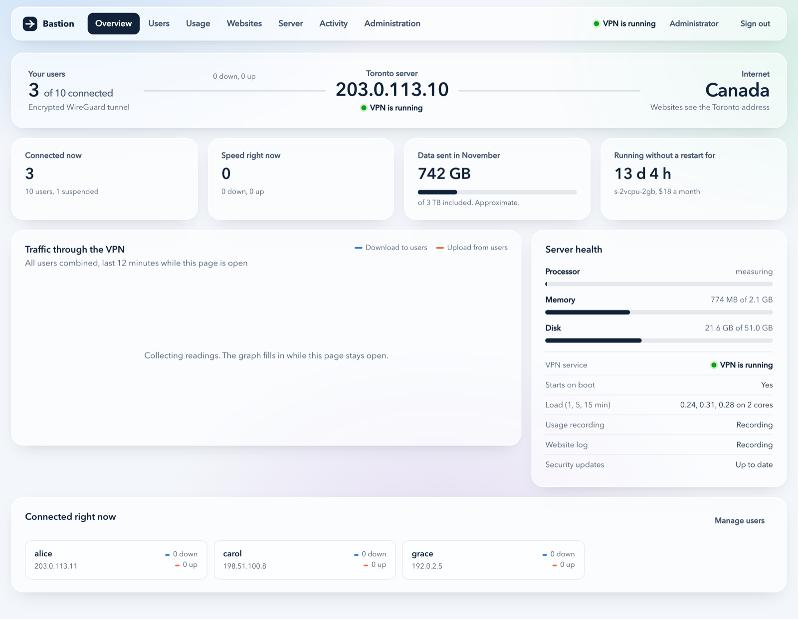
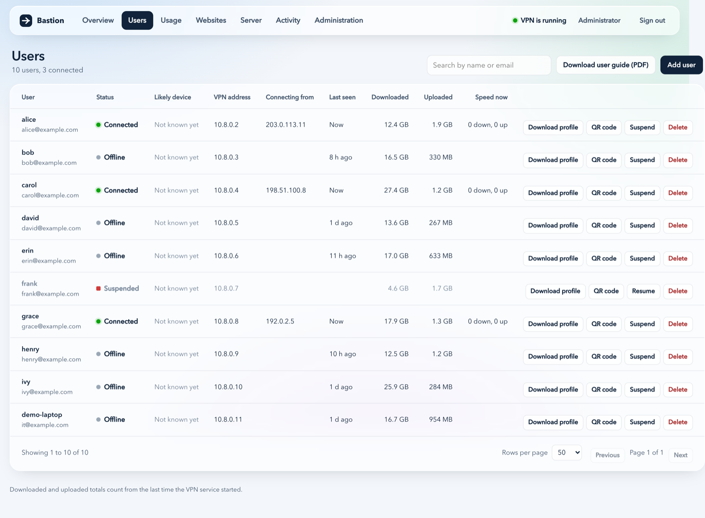
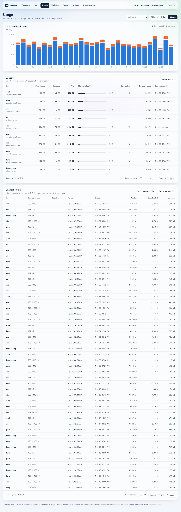
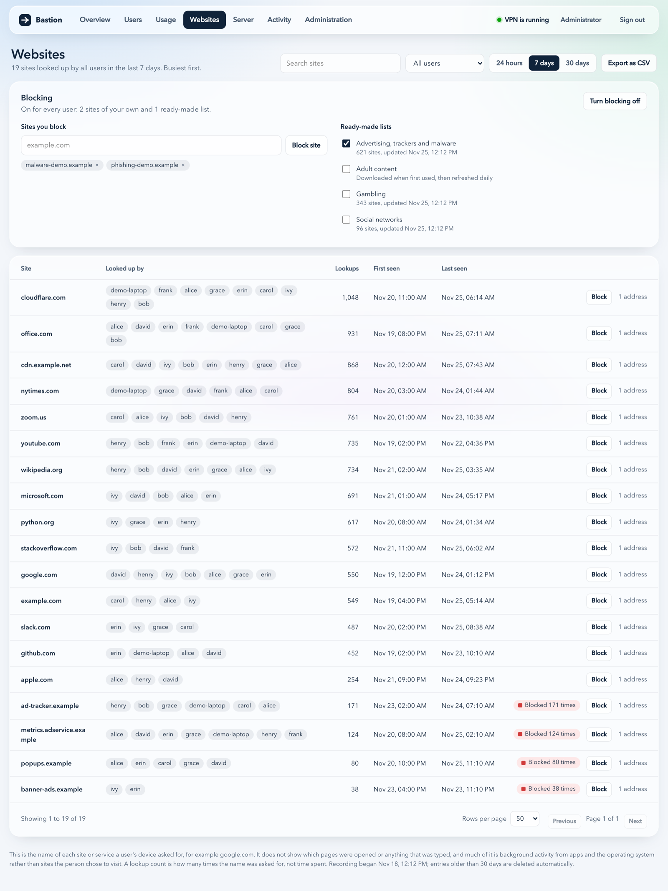
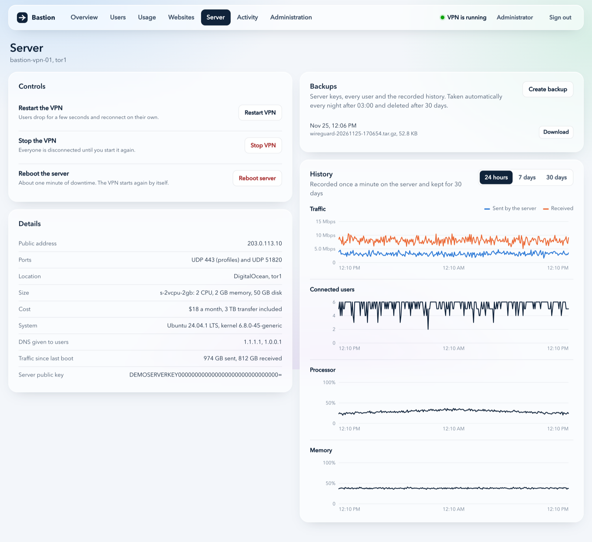
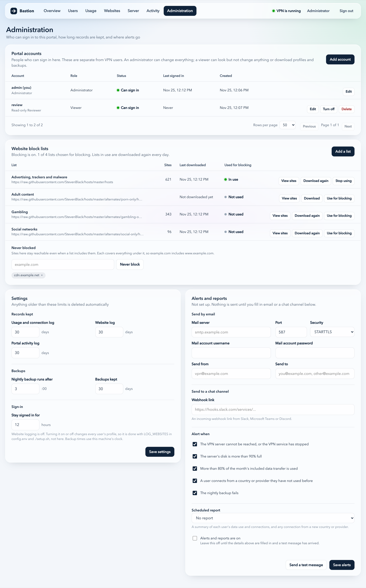

# Bastion

**A self-hosted WireGuard VPN with a web management portal — one folder of scripts provisions the server, hands out profiles, and gives you a login-protected console for users, usage, auditing, website controls and backups.**

Bastion stands up a hardened WireGuard server on a DigitalOcean droplet and manages it entirely from scripts on a machine you control. A FastAPI web portal (run in Docker on your LAN) adds per-user management, live monitoring, an audit log, retention controls, optional website logging and blocking, alerts, and nightly backups.

> ⚠️ **Run it only on infrastructure you own, for users who know they are using it.** Bastion can record connection metadata and the domain names users look up. Whether you may do that — and what notice you must give — depends on your jurisdiction and your relationship with the users. See [Monitoring, privacy & the law](docs/monitoring-and-privacy.md) before enabling any logging.


---

## Contents

- [Features](#features)
- [How it fits together](#how-it-fits-together)
- [Requirements](#requirements)
- [Quick start](#quick-start)
- [The web portal](#the-web-portal)
- [Day-to-day scripts](#day-to-day-scripts)
- [What is recorded](#what-is-recorded)
- [Security model](#security-model)
- [Documentation](#documentation)
- [Credits](#credits)
- [License](#license)

---

## Features

- **One-command provisioning** — `./setup.sh` creates the SSH key, droplet and cloud firewall, installs and hardens WireGuard, and generates profiles.
- **Full-tunnel WireGuard** on UDP 443 (with 51820 as fallback) so it passes most hotel and guest networks.
- **Web portal** (FastAPI in Docker, runs on your LAN) with per-account sign-in and two roles.
- **Per-user management** — add, suspend, resume, delete; download `.conf` profiles and QR codes.
- **Live monitoring** — current connections, server health history, per-user usage, connection log.
- **Audit log** — every portal action is attributed to the account that performed it.
- **Optional website logging** — records the domain names each user's device looks up (off at the DNS layer unless enabled).
- **Optional website blocking** — curated block lists (ads/malware, adult, gambling, social) plus your own lists and a never-blocked allow list.
- **Alerts & reports** — email (SMTP) and/or webhook (Slack/Teams/Discord) for VPN down, disk full, transfer cap, new connection location, failed backup; daily/weekly usage report.
- **Automatic retention** — usage, website log, audit log and backups all expire on configurable schedules.
- **Nightly backups** of server keys, users, settings and history.
- **End-user PDF guide** generator for Windows/macOS/Android onboarding.
- **Throwaway SOCKS proxy** helper (`socks.sh`) for quick browser-egress testing on a separate droplet.

## How it fits together

```
┌────────────────────────┐        SSH (key-only)        ┌─────────────────────────────┐
│  Management machine     │ ───────────────────────────▶ │  DigitalOcean droplet       │
│  (your Mac/Linux box)   │                               │  Ubuntu 24.04 + WireGuard   │
│                         │                               │                             │
│  • scripts (./*.sh)     │                               │  • wg0  (10.8.0.0/24)       │
│  • web portal (Docker)  │ ◀──── usage / status ──────── │  • dnsmasq (log + block)    │
│  • profiles/ backups/   │                               │  • cloud + host firewall    │
└────────────────────────┘                               └──────────────┬──────────────┘
         ▲                                                               │ full tunnel
         │ LAN, http://…:8844                                           ▼
   you + viewers                                                 VPN users' devices
```

The management machine never exposes anything to the internet. Users only ever talk to the droplet, over WireGuard.

## Requirements

On the management machine (macOS or Linux):

- [`doctl`](https://docs.digitalocean.com/reference/doctl/) — `brew install doctl`
- [`jq`](https://jqlang.github.io/jq/) — `brew install jq`
- [Docker](https://www.docker.com/) (for the portal)
- A DigitalOcean account and API token

## Quick start

```bash
# 1. Clone
git clone git@github.com:dhavz/bastion-wg.git && cd bastion-wg

# 2. Add your DigitalOcean API token (see DOToken.example)
printf '%s' 'YOUR_DO_API_TOKEN' > DOToken

# 3. (Optional) list the users you want profiles for
cp users.example.txt users.txt && $EDITOR users.txt

# 4. Review defaults (region, size, ports, DNS, logging)
$EDITOR config.env

# 5. Provision everything (safe to re-run)
./setup.sh

# 6. Start the web portal
./portal.sh start
./portal.sh password      # the starting password for the "admin" account
```

Then open the portal at the LAN address `./portal.sh status` prints, and sign in as `admin`.

Onboard a user:

```bash
./add-user.sh alice
# send them profiles/alice.conf + the generated PDF guide,
# or have them scan profiles/alice.png in the WireGuard app
```

Full walkthrough: **[Getting started](docs/getting-started.md)**.

## The web portal

```
./portal.sh start      # build and run it in Docker
./portal.sh status     # is it running, and at which LAN address
./portal.sh password   # starting password of the "admin" account
./portal.sh new-password   # locked out? reset the admin account
./portal.sh stop
```

People sign in with their own account so the **Activity** tab shows who did what. Roles:

- **Administrator** — full control.
- **Viewer** — can see every page but change nothing, and cannot download profiles, QR codes or backups.

The **Administration** tab holds retention/schedule settings, website block-list management, and alerts/reports. Deep dives: **[Portal accounts & roles](docs/portal-accounts.md)**, **[Administration tab](docs/administration.md)**.

> The portal speaks plain HTTP for your LAN. Run it on a trusted network and do not forward the port to the internet. See [Security model](#security-model).

### Screenshots

> Shown with seeded demo data — the users, addresses and traffic below are synthetic, not real.

| Overview | Users |
|---|---|
| [](docs/images/01-overview.png) | [](docs/images/02-users.png) |

| Usage | Websites |
|---|---|
| [](docs/images/03-usage.png) | [](docs/images/04-websites.png) |

| Server | Administration |
|---|---|
| [](docs/images/05-server.png) | [](docs/images/07-administration.png) |

## Day-to-day scripts

| Script | What it does |
|---|---|
| `./manage.sh` | Interactive menu for everything below |
| `./status.sh` | Droplet state, VPN service, load, traffic, who is connected |
| `./add-user.sh [name]` | Create a user, download their profile and QR code |
| `./remove-user.sh [name]` | Revoke a user immediately |
| `./list-users.sh` | Users, last seen, data used |
| `./create-profiles.sh` | Create a profile for everyone in `users.txt` who lacks one |
| `./start.sh` / `./stop.sh [--poweroff]` | Start / stop the VPN (optionally power the droplet off) |
| `./restart.sh [--reboot]` | Restart WireGuard, or reboot the server |
| `./ssh.sh [command]` | Root shell on the server, or run one command |
| `./backup.sh` / `./restore.sh [file]` | Download / restore server keys + all users |
| `./test-profile.sh <name>` | Connect with a profile from a Docker container and check it end to end |
| `./portal.sh …` | The web portal |
| `./build-guide.sh` | Rebuild the end-user PDF with the current server IP |
| `./socks.sh up\|status\|allow\|down` | Temporary SOCKS5 proxy on a separate droplet (testing) |
| `./setup.sh` / `./destroy.sh` | Provision from scratch / delete the droplet and firewall |

Reference: **[Script reference](docs/script-reference.md)**.

## What is recorded

The server samples once a minute, whether or not the portal is open, into one database on the droplet (included in every backup):

- **Usage** — data up/down per user, in 5-minute slices.
- **Connections** — when each user connected/disconnected, from which address, and how much data moved.
- **Websites** (only when `LOG_WEBSITES="yes"`) — the domain names each user's device looked up (e.g. `example.com`), never page addresses or content. Apps using their own encrypted DNS do not appear.
- **Server health** — CPU, memory, disk, traffic, connected users.

The portal enriches these with approximate **location/provider** (from DB-IP's free, locally-stored databases — no user address leaves your machine), **new country/provider** flags, and a **likely device type** guess. Full detail and the privacy implications: **[What is recorded](docs/what-is-recorded.md)** and **[Monitoring, privacy & the law](docs/monitoring-and-privacy.md)**.

## Security model

- SSH is **key-only**; password login disabled. The server private key lives only on your management machine (and in backups) — it is **not** in this repository.
- **DigitalOcean cloud firewall + host `ufw`**: only SSH and the WireGuard ports are open inbound.
- Full tunnel; IPv6 from clients is captured and refused so it cannot leak around the VPN.
- VPN users cannot reach each other's devices.
- Each user has their own key pair and preshared key; revoking one does not affect the others.
- Unattended security updates; auto-reboot window with the VPN self-recovering.
- **The portal is plain HTTP** — intended for a trusted LAN only. Passwords are stored as scrypt hashes; the mail password and audit log live in a git-ignored local database.

More: **[Security model](docs/security-model.md)**.

### What never belongs in this repo

`DOToken`, `keys/`, `.state/`, `profiles/`, `backups/`, `users.txt` and any built PDF are all git-ignored. They contain tokens, private keys, server addresses and personal data. Keep your working copy of them backed up somewhere safe and private.

## Documentation

Detailed per-feature docs live in [`docs/`](docs/) and mirror the project wiki:

| Page | |
|---|---|
| [Getting started](docs/getting-started.md) | Provision, onboard the first users |
| [Architecture](docs/architecture.md) | How the pieces connect |
| [Portal accounts & roles](docs/portal-accounts.md) | Sign-in, admin vs viewer |
| [Administration tab](docs/administration.md) | Settings, block lists, alerts |
| [What is recorded](docs/what-is-recorded.md) | Every data point and where it lives |
| [Website logging & blocking](docs/website-controls.md) | DNS logging, block lists, allow list |
| [Backups & restore](docs/backups.md) | Nightly backups, restoring a server |
| [Security model](docs/security-model.md) | Firewalls, hardening, threat model |
| [Monitoring, privacy & the law](docs/monitoring-and-privacy.md) | Notice, consent, retention |
| [Script reference](docs/script-reference.md) | Every script, flag by flag |
| [SOCKS proxy helper](docs/socks-proxy.md) | The `socks.sh` testing tool |
| [Troubleshooting](docs/troubleshooting.md) | Common issues |

## Credits

Bastion is a thin management layer over excellent open-source and open-data projects:

- [**WireGuard**](https://www.wireguard.com/) — the VPN tunnel (© Jason A. Donenfeld; GPLv2 kernel module / MIT tools).
- [**dnsmasq**](https://thekelleys.org.uk/dnsmasq/doc.html) — DNS logging and blocking on the server.
- [**Dante**](https://www.inet.no/dante/) — the SOCKS5 server used by the `socks.sh` helper.
- [**FastAPI**](https://fastapi.tiangolo.com/) & [**Uvicorn**](https://www.uvicorn.org/) — the portal's web framework and server.
- [**Docker**](https://www.docker.com/) — runs the portal.
- [**doctl**](https://github.com/digitalocean/doctl) & [**DigitalOcean**](https://www.digitalocean.com/) — the cloud API and host.
- [**ReportLab**](https://www.reportlab.com/) — generates the end-user PDF guide.
- [**StevenBlack/hosts**](https://github.com/StevenBlack/hosts) (MIT) — the curated block lists.
- [**DB-IP**](https://db-ip.com/) — free IP-to-location databases ([CC BY 4.0](https://creativecommons.org/licenses/by/4.0/)).
- [**Ubuntu**](https://ubuntu.com/) — the server OS.

Trademarks and projects belong to their respective owners; their inclusion here does not imply endorsement.

## License

[MIT](LICENSE) © 2026 Dhaval Prajapati. The bundled/third-party components above keep their own licenses.
