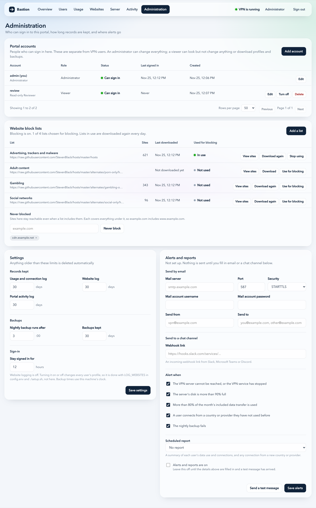

# Administration tab

Admin-only. Three panels: **Settings**, **Website block lists**, **Alerts & reports**.

## Settings

| Setting | Stored in | Notes |
|---|---|---|
| Usage log retention | server + `config.env` | days of per-user usage kept |
| Website log retention | server + `config.env` | days of looked-up domains kept |
| Portal activity (audit) retention | `.state/portal.db` | days of admin-action log kept |
| Backup retention | `.state/portal.db` | days of nightly backups kept |
| Nightly backup hour | `.state/portal.db` | when the backup runs (after this hour) |
| Sign-in lifetime | `.state/portal.db` | how long a session lasts |

The two **server** retention periods are written both to the server and back into
`config.env`, so the scripts and the portal agree. Everything else lives in the local portal
database.

## Website block lists

See, manage and curate the lists used for [website blocking](website-controls.md):

- **View sites** — open any list with search and 50-per-page paging (large lists run to
  thousands of entries).
- **Download / Download again** — fetch a list now instead of waiting for the daily refresh.
- **Use for blocking / Stop using** — the same choice as the tick boxes on the Websites tab.
- **Add a list** — give a name and an `https://` link to a published list (a hosts file or
  one domain per line). The server downloads it immediately to validate it; bad links are
  rejected.
- **Never blocked** — an allow list of domains that stay reachable even when a block list
  includes them. Add one by typing it, or press **Never block** beside any site while
  viewing a list.

Guardrails: a domain cannot be both blocked by you and on the never-blocked list; the portal
refuses the clash. Never-blocked only overrides **lists** — a site you block yourself stays
blocked.

## Alerts & reports

Off until configured. Delivery can be **email** (any SMTP account) and/or a **webhook**
(Slack, Teams or Discord incoming webhook). Events:

| Alert | Fires when |
|---|---|
| VPN down | the service stops responding |
| Disk full | disk usage crosses 90% |
| Transfer cap | monthly transfer crosses 80% of the allowance |
| New location/provider | a user connects from a country/ISP they haven't before |
| Backup failed | a nightly backup does not complete |

A **usage report** can be sent daily or weekly at 08:00.

The background checker runs every 60s and remembers state between runs (so you are not paged
repeatedly for the same ongoing condition). The mail password is stored in
`.state/portal.db`, which is git-ignored. Use **Send test** to confirm delivery.

> Alerts that depend on location use the local DB-IP databases; no user address is sent to an
> outside service.
