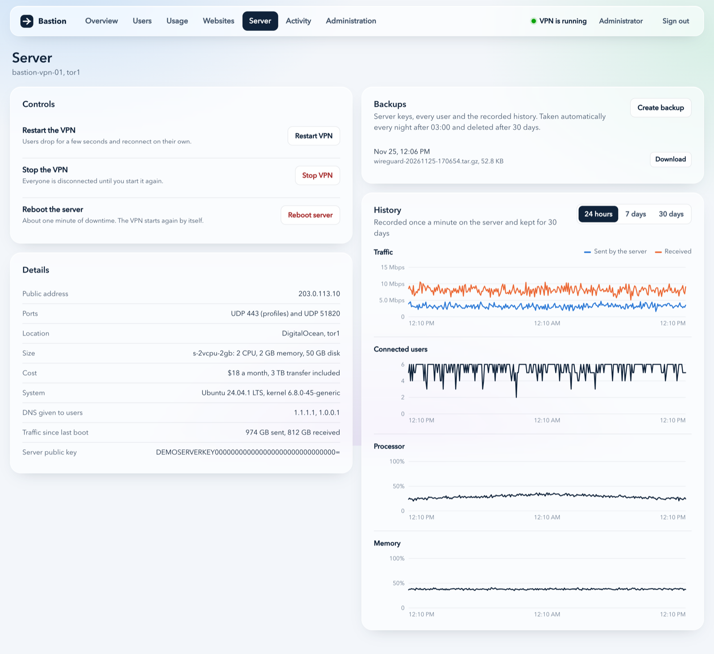

# Architecture



Three parts: the **management machine**, the **droplet**, and the **users' devices**.

```
┌────────────────────────┐        SSH (key-only, 22/tcp)   ┌─────────────────────────────┐
│  Management machine     │ ──────────────────────────────▶ │  DigitalOcean droplet       │
│  (your Mac/Linux box)   │                                  │  Ubuntu 24.04               │
│                         │                                  │                             │
│  scripts  (./*.sh)      │                                  │  WireGuard  wg0  10.8.0.1   │
│  portal   (Docker,8844) │ ◀──── vpn-usage / vpn-status ─── │  dnsmasq   (DNS log+block)  │
│  profiles/ backups/     │                                  │  usage.db  (per-minute)     │
│  config.env .state/     │                                  │  ufw + DO cloud firewall    │
└────────────────────────┘                                  └──────────────┬──────────────┘
         ▲  LAN only                                                        │ full tunnel
         │  http://<lan-ip>:8844                                            │ UDP 443 → 51820
    admins + viewers                                                        ▼
                                                                    users' devices
                                                             (WireGuard app, all traffic)
```

## Management machine

Runs everything; exposes nothing to the internet.

- **Scripts** (`./setup.sh`, `./add-user.sh`, …) call the DigitalOcean API via `doctl` and
  the server via SSH. Shared helpers live in `lib/common.sh`.
- **Portal** runs in a Docker container (`vpn-portal`, host port 8844 → 8080). It mounts the
  project directory, reads/writes `profiles/`, `backups/`, `users.txt`, and talks to the
  server over an SSH ControlMaster connection.
- **Local state** in `.state/`: droplet id, server IP, `known_hosts`, the portal's SQLite
  database (`portal.db`: accounts, settings, audit log) and `portal.env` (port + starting
  password). All git-ignored.

## Droplet

Ubuntu 24.04 with:

- **WireGuard** (`wg0`) on `10.8.0.0/24`, server at `.1`. Listens on UDP 51820; a REDIRECT
  sends UDP 443 to it as well, so profiles can use the friendlier port.
- **dnsmasq** bound to `10.8.0.1` — answers VPN users' DNS, logs the looked-up names per user,
  and (when enabled) blocks lists via `address=/domain/#` and `addn-hosts`.
- **`usage.db`** (SQLite) — a cron/timer samples `wg` every minute: per-user transfer,
  connection events, and server health.
- **Server tools** in `/usr/local/sbin`: `vpn-user`, `vpn-status`, `vpn-usage`, `vpn-block`.
- **Firewalls** — DigitalOcean cloud firewall (attached by tag) plus host `ufw`; only SSH and
  the WireGuard ports are open inbound.

## Users' devices

Run the official WireGuard client and import a `.conf` (or scan a QR). Full tunnel: **all**
traffic exits at the droplet. IPv6 from the client is captured and refused so it cannot leak.

## Data flow for monitoring

1. User's device sends traffic + DNS through the tunnel.
2. dnsmasq answers DNS, records the domain against the user's tunnel IP.
3. The per-minute sampler writes usage/connection/health rows to `usage.db`.
4. The portal reads `usage.db` over SSH and enriches it with local geo-IP data.

See [What is recorded](what-is-recorded.md) for the exact fields.
