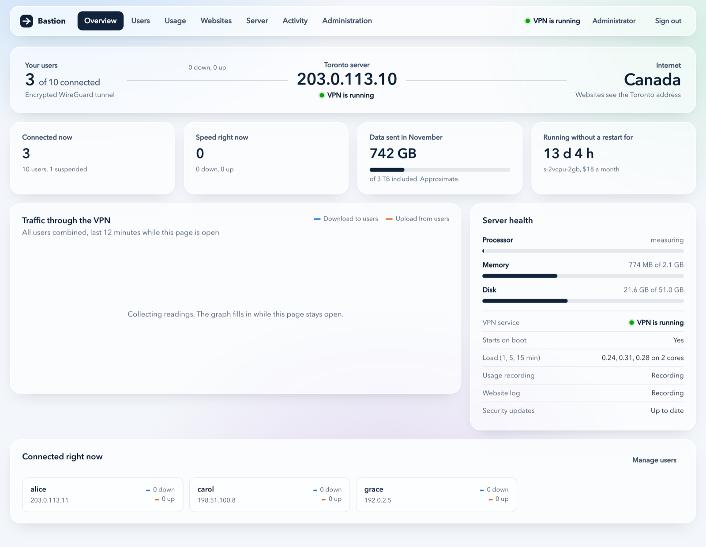

# Getting started



This walks you from an empty DigitalOcean account to connected users.

## 1. Prerequisites

On the machine that will manage the VPN (macOS or Linux):

```bash
brew install doctl jq        # macOS; use your package manager on Linux
# Docker Desktop (or Docker Engine) installed and running — needed for the portal
```

Create a DigitalOcean **API token** (read + write) at
<https://cloud.digitalocean.com/account/api/tokens>.

## 2. Configure

```bash
git clone git@github.com:dhavz/bastion-wg.git
cd bastion-wg

printf '%s' 'YOUR_DO_API_TOKEN' > DOToken     # git-ignored
cp users.example.txt users.txt                # optional roster
$EDITOR users.txt                             # "Name: email" per line
$EDITOR config.env                            # region, size, ports, DNS, logging, retention
```

Key settings in [`config.env`](../config.env):

| Setting | Meaning |
|---|---|
| `REGION` | DigitalOcean region slug (`doctl compute region list`) |
| `SIZE` | Droplet size — determines monthly transfer allowance |
| `CLIENT_PORT` | UDP port in profiles (443 slips through most networks) |
| `LOG_WEBSITES` | `yes` records looked-up domains; `no` records nothing at the DNS layer |
| `*_RETENTION_DAYS` | How long usage / website / audit data is kept |

## 3. Provision

```bash
./setup.sh
```

This is **idempotent** — safe to re-run. It:

1. Generates the server SSH key in `keys/` (if absent).
2. Creates the droplet and a cloud firewall (SSH + WireGuard only).
3. Installs and hardens WireGuard, dnsmasq, firewall and tuning.
4. Creates a profile for everyone in `users.txt`.

When it finishes, `./status.sh` shows the server as active.

## 4. Start the portal

```bash
./portal.sh start
./portal.sh status      # prints the LAN URL, e.g. http://192.168.x.x:8844
./portal.sh password    # starting password for the "admin" account
```

Open the URL on any device on the same network and sign in as `admin`. Change the
password from the button bearing your name in the top bar, and create more accounts on
the **Administration** tab. See [Portal accounts & roles](portal-accounts.md).

## 5. Onboard a user

```bash
./add-user.sh alice
```

Send them `profiles/alice.conf` and the PDF guide (`./build-guide.sh` builds it with your
server's address). Phone users can scan `profiles/alice.png` in the official WireGuard app.

> One profile per device. The same profile active on two devices at once makes both drop.

## 6. Hand out the guide

```bash
./build-guide.sh         # writes docs/VPN-User-Guide.pdf (git-ignored)
```

The PDF covers installing WireGuard, importing the profile, connecting, and verifying the
exit IP — and plainly states what is recorded while connected.

## Next

- [Architecture](architecture.md)
- [Administration tab](administration.md)
- [Monitoring, privacy & the law](monitoring-and-privacy.md) — **read before enabling logging**
