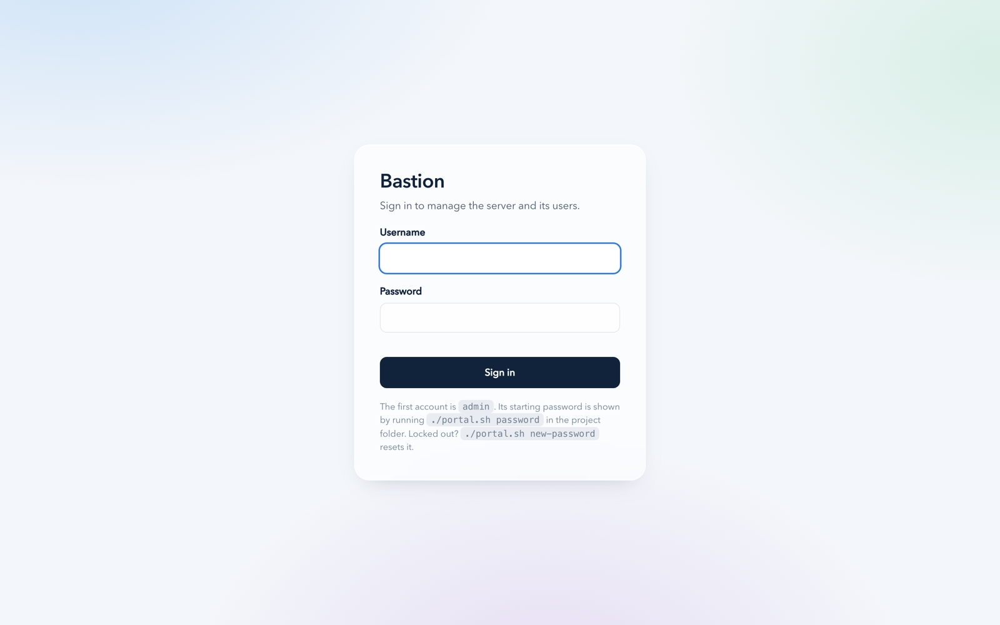

# Portal accounts & roles



Everyone signs in with their own account, so the **Activity** tab can attribute each action
to a person.

## The first account

`admin` is created automatically. Its starting password comes from `PORTAL_PASSWORD` in
`.state/portal.env`:

```bash
./portal.sh password       # show it
```

Change it from the button with your name in the top bar after first sign-in.

## Roles

| Capability | Administrator | Viewer |
|---|:---:|:---:|
| View all pages (connections, usage, logs, health) | ✓ | ✓ |
| Add / suspend / resume / delete users | ✓ | — |
| Download profiles, QR codes, backups | ✓ | — |
| Change settings, block lists, alerts | ✓ | — |
| Start/stop VPN, reboot server, take backups | ✓ | — |
| Manage portal accounts | ✓ | — |
| Change **own** password | ✓ | ✓ |

A viewer is a safe read-only login for someone who should see activity but touch nothing.

## Managing accounts

On **Administration → Portal accounts**:

- **Add** an account (username + role + initial password).
- **Edit** a role or reset a password.
- **Delete** an account.

Guards that the portal enforces:

- You cannot remove your **own** administrator access.
- You cannot delete the **last** administrator.
- Passwords must be at least 10 characters.

## Password storage

Passwords are stored only as **scrypt hashes** (n=2¹⁴) in `.state/portal.db`. Sessions are
in-memory tokens that expire after the configured sign-in lifetime (Administration → Settings).

## Locked out?

If the `admin` password is lost:

```bash
./portal.sh new-password
```

This writes a fresh random password to `.state/portal.env`, restarts the portal, and
re-enables `admin` as an administrator. Other accounts are untouched.

> Because the portal is plain HTTP, account passwords cross the LAN unencrypted. Use it only
> on a trusted network — see [Security model](security-model.md).
