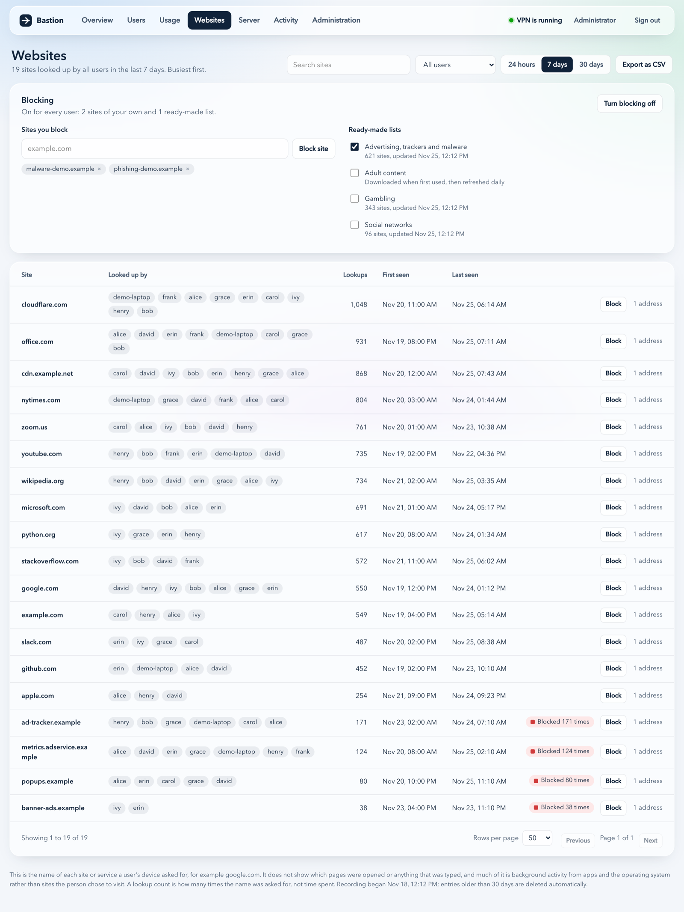

# Website logging & blocking

Both features work at the **DNS** layer, handled by dnsmasq on the server. Both require
`LOG_WEBSITES="yes"` (that is what makes the server answer users' DNS), and both can be
bypassed by an app or browser that uses its own encrypted DNS (DoH/DoT).

## Logging

When `LOG_WEBSITES="yes"`, the server records the domain names each user's device looks up —
names only, never page addresses or content. See [What is recorded](what-is-recorded.md).

Turning this on or off changes the DNS line written into every profile, so **re-send the
profiles** after changing it (`./setup.sh` regenerates them).

## Blocking

Off by default. On the portal's **Websites** page you choose what to block, then flip blocking
on. Blocking applies to **every** user, and blocked lookups are still counted per user in the
website log.

Sources of what to block:

- **Your own sites** — type specific domains.
- **Ready-made lists** from the [StevenBlack/hosts](https://github.com/StevenBlack/hosts)
  project (MIT), refreshed daily:
  - Advertising, trackers & malware
  - Adult content
  - Gambling
  - Social networks
- **Custom lists** — add any published list by `https://` link (a hosts file or one domain
  per line), up to 20 lists / 40 MB each.

## Allow list ("Never blocked")

Domains on the never-blocked list stay reachable even if a block list contains them. Manage it
on **Administration → Website block lists**. It overrides lists only — a domain you blocked
yourself stays blocked, and the portal refuses to put the same domain in both places.

## How it is applied on the server

- A domain blocked by a list resolves to `0.0.0.0` (via `address=/domain/#` and `addn-hosts`).
- Each active list is filtered through the allow list into
  `/etc/vpn-block/<key>.active`, which dnsmasq reads.
- `vpn-block` (in `/usr/local/sbin`) manages lists: `show`, `set`, `refresh`,
  `update <list>`, `list <list> [--search --offset --limit]`.

## Limitations

- **Global, not per-user** — blocking is server-wide.
- **DNS-based** — encrypted DNS or hard-coded resolver IPs can bypass it.
- Only lists that are *in use* are refreshed daily.
