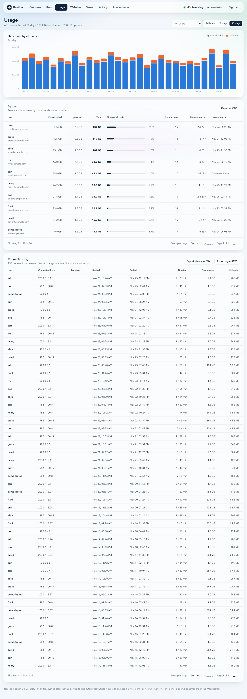

# What is recorded

The server samples once a minute — whether or not the portal is open — into one SQLite
database on the droplet (`/etc/wireguard/usage.db`), which is included in every backup.

## On the server

| Data | Detail | Depends on |
|---|---|---|
| **Usage** | Bytes up/down per user, in 5-minute slices | always |
| **Connections** | Connect/disconnect time, source address, data moved per connection | always |
| **Websites** | Domain names each user's device looked up (e.g. `example.com`) — never full URLs, page content or passwords | `LOG_WEBSITES="yes"` |
| **Server health** | CPU, memory, disk, traffic, connected users | always |

How the website log works: when `LOG_WEBSITES="yes"`, profiles use the server itself as their
DNS resolver, and the server also intercepts lookups aimed at any other DNS server. dnsmasq
records the queried name against the user's tunnel IP. Apps or browsers using their own
**encrypted DNS** (DoH/DoT) bypass this and do **not** appear.

## Added by the portal when it displays them

| Field | Source | Notes |
|---|---|---|
| **Location & provider** | DB-IP free databases, stored in `.state/geo/`, refreshed monthly | City is approximate; **no user address is sent to any outside service** |
| **New country / new provider** | compared to that user's own history | flags a connection from somewhere new |
| **Likely device** (Windows/Apple/Android/Linux) | guessed from background check-ins in the website log | WireGuard itself reports nothing about the device |

## Retention

Everything expires automatically:

- `USAGE_RETENTION_DAYS` — usage, connection log, portal audit log (default 30)
- `SITE_RETENTION_DAYS` — website log (default 30)
- `BACKUP_KEEP_DAYS` — nightly backups (default 30)

Change them on **Administration → Settings** (which also updates `config.env`), or edit
`config.env` and re-run `./setup.sh`.

## Where each thing lives

| Store | Location | In git? |
|---|---|---|
| Usage / connections / websites / health | `usage.db` on the droplet (and in backups) | no |
| Portal accounts, settings, **audit log** | `.state/portal.db` on the management machine | no |
| Geo-IP databases | `.state/geo/` | no |

## Please read

Recording browsing activity has legal and trust implications. See
[Monitoring, privacy & the law](monitoring-and-privacy.md) before enabling `LOG_WEBSITES`.
